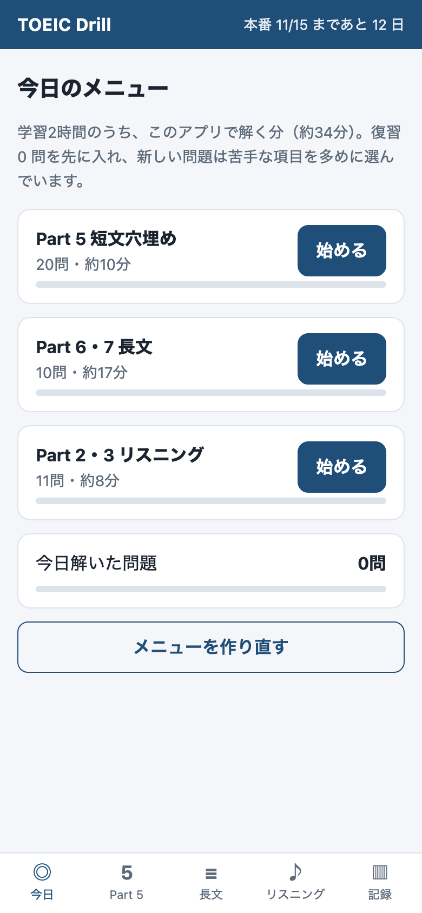
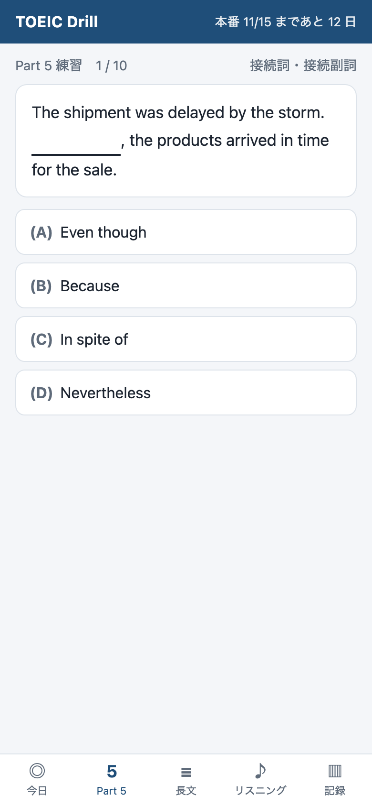
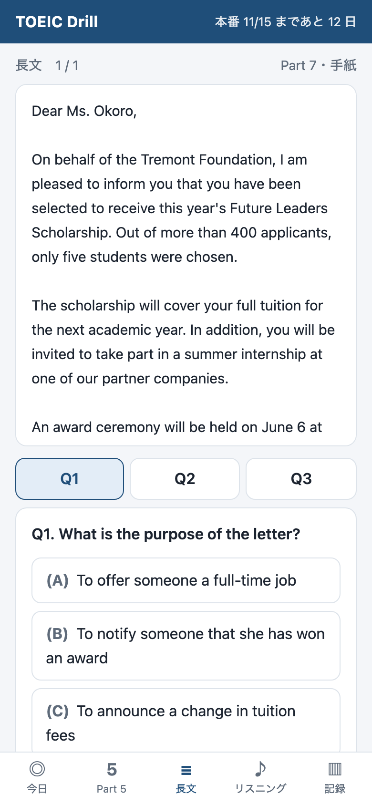
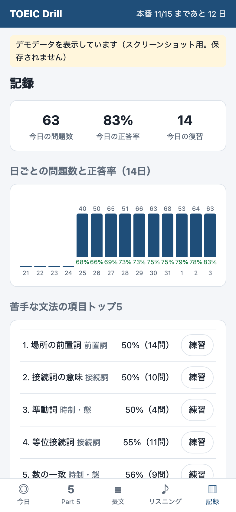

# TOEIC Drill

TOEIC L&R 本番（2026年11月15日・目標800点）までの2週間、毎日使うための自分専用の練習アプリ。
語彙は別のアプリで学ぶので、このアプリは **文法・読解・リスニングを「解く練習」** に絞っている。

- `index.html` を中心にした静的なWebアプリ（ビルド不要・外部ライブラリなし）
- スマホのブラウザ向けの画面。PWA なのでホーム画面に置け、一度開けば通信なしでも動く
- 学習の記録はブラウザの `localStorage` に保存。保存できない環境（プライベートモード等）でも解くことはできる
- 記録画面から JSON で書き出し・読み込みができる

| 今日のメニュー | Part 5 | 長文 | 記録 |
|---|---|---|---|
|  |  |  |  |

（記録画面のスクリーンショットは `?demo=1` のデモデータで表示したもの。デモデータは保存されない）

## できること

1. **Part 5 短文穴埋め** — オリジナル問題 310 問。品詞・時制/態・前置詞・接続詞・関係詞・語法を本番の比率に近く混ぜている。1問ごとに日本語の解説（なぜその答えか、ほかの選択肢がなぜ違うか）。選択肢の並びは毎回入れ替わる。
2. **Part 6・7 長文** — オリジナルの文書（メール・告知・記事・チャット・広告・フォームなど）41 セット、各 2〜4 問。本文の下の **Q1・Q2・Q3 のタブ** で設問を切り替えられ、好きな順に解ける（本文のスクロール位置はそのまま）。答えると、本文の根拠の文に黄色の印が付く。
3. **Part 2・3 リスニング** — ブラウザの音声読み上げ（Web Speech API の `speechSynthesis`、英語の声）で読み上げる。Part 3 は話者ごとに別の声。英語の声が無い端末では自動で文字表示に切り替わる。速さ（0.8〜1.1）と「最初から文字を表示」を設定できる。
4. **間隔反復** — 間違えた問題は、間違えた日から数えて **翌日・3日後・7日後** に戻ってくる。そこで正解し続ければ 21 日後へ。初めて解いて正解した問題は 14 日後、その後は 30 日後と、出る頻度を下げる。
5. **時間計測モード** — Part 5 を「1問20秒」で解く。残り時間のバーが出て、時間切れは不正解として記録。終わると平均秒数を記録する。
6. **今日のメニュー** — 1日2時間のうちこのアプリに使う 30〜40 分ぶんを自動で選ぶ（Part 5 20〜30問・長文3セット・リスニング約11問）。復習を先に入れ、新しい Part 5 は正答率の低い文法項目ほど出やすくしている。メニューはその日のあいだ固定で、進み具合も保存される。
7. **記録画面** — 今日の問題数・正答率・復習数、14日分の問題数と正答率のグラフ、苦手な文法の項目トップ5（その項目だけを練習するボタン付き）、パート別の累計。
8. **リザルト画面の振り返り** — 解き終わると、解いた問題が ○× 付きで一覧になる。タップすると、正解・自分の答え・解説・**日本語訳** が開く。長文と Part 3 は本文ごとにまとめ、「本文（会話）と日本語訳を見る」で英文と訳を並べて読める。
9. **用語集** — 解説に出てくる文法用語（46語）。初めて出てきたときに、一言の説明と例え話をその場に表示する。

## 問題データの件数と点検の結果

`python3 tools/check.py` の出力（2026-11-03 時点）:

```
## 問題データの件数
- Part 5: 310問
  - 品詞: 88問（28%）
  - 時制・態: 53問（17%）
  - 前置詞: 45問（15%）
  - 接続詞: 44問（14%）
  - 関係詞: 28問（9%）
  - 語法: 52問（17%）
- Part 6: 12セット / Part 7: 29セット（計41セット・126問）
- リスニング: Part 2 41問 + Part 3 8会話24問（計65問）
- 用語集: 46語
- 文法の小項目: 33種類
- アプリの版: v3（sw.js: v3）

## 点検の結果: 不備 0 件
```

点検していること（`tools/check.py`）:

- **全体**: JSON として読めるか／同じ問題文の重複
- **Part 5**: 空所 `___` がちょうど1つ／選択肢が4つで重複なし（大文字小文字・空白の違いも重複とみなす）／解説に正解の語句が出てくるか（答えのずれの検出）／解説が誤りの選択肢すべてに触れているか／解説の「正解は〜」が正解と一致するか／正解を入れると同じ語が連続しないか
- **長文**: 1セット2〜5問／選択肢4つで重複なし／根拠の文が本文にそのまま存在するか／Part 6 の空所の番号と数が設問と合っているか
- **リスニング**: Part 2 は選択肢3つ、Part 3 は4つで重複なし／Part 3 の根拠の文が会話にそのまま存在するか
- **用語**: 解説の【用語】がすべて用語集にあるか／用語集の語がどこかで使われているか
- **日本語訳**: すべての問題・本文・会話に訳があるか／訳の数（設問数・発言数）が合っているか
- **版番号**: `sw.js` の `VERSION` の数字と `app.js` の `APP_VERSION` が一致するか

問題はすべてこのアプリのために書いたオリジナル。公式問題集や市販教材の問題を写したり言い換えたりしたものは含まない。

## GitHub Pages で公開する手順

1. このリポジトリを GitHub に push する（`main` ブランチ）。
2. GitHub のリポジトリ画面で **Settings → Pages** を開く。
3. **Build and deployment** の **Source** を「Deploy from a branch」にする。
4. **Branch** を `main`、フォルダを `/ (root)` にして **Save**。
5. 1〜2分待つと、同じ画面に `https://<ユーザー名>.github.io/toeic-drill/` のURLが出る。
   - リポジトリが private の場合、GitHub Pages を使うには有料プランが必要。無料プランなら public にする。
6. スマホでそのURLを開き、ホーム画面に追加する。
   - iPhone（Safari）: 共有ボタン → 「ホーム画面に追加」
   - Android（Chrome）: メニュー → 「ホーム画面に追加」／「アプリをインストール」
7. 一度開けば、以後は通信なしでも動く（Service Worker が全ファイルを端末に保存する）。

問題や画面を更新したときは、`sw.js` の `VERSION` と `app.js` の `APP_VERSION` を同じ数字に上げてから push する（例: `toeic-drill-v3` と `3` → `toeic-drill-v4` と `4`。ずれていると `python3 tools/check.py` が不備として数える）。上げないと、端末に保存された古い版が使われ続ける。ヘッダーの「TOEIC Drill」の横に出る版番号（例: `v3`）で、新しい版が反映されたかを確認できる（記録画面の一番下にも出る）。更新後、スマホではアプリを**2回開き直す**と新しい版になる（1回目で新しい版を取り込み、2回目から表示される）。

## 記録の保存について

- 記録はそのブラウザの中だけにある。別の端末やブラウザとは共有されない。
- 機種変更やブラウザのデータ削除に備えて、ときどき **記録 → 書き出し（JSON）** で保存しておく。**読み込み** で元に戻せる（今の記録は置き換わる）。
- iPhone の Safari は、長く開かないサイトのデータを消すことがある。ホーム画面に追加して使うと消えにくい。

## 手元で動かす

```bash
python3 -m http.server 8765
```

ブラウザで http://localhost:8765/ を開く。`index.html` を直接ファイルとして開いても動く（その場合オフライン機能は無効）。

```bash
python3 tools/check.py
```

問題データを点検する（不備があれば終了コード 1）。

```bash
bash tools/screenshots.sh
```

スクリーンショットを撮り直す（macOS + Google Chrome。上のサーバーを動かした状態で。ポートが違うときは `PORT=8766 bash tools/screenshots.sh`）。

## ファイル構成

```
index.html            画面の骨組み
style.css             見た目（スマホ向け・ダークモード対応）
app.js                出題・間隔反復・今日のメニュー・記録・読み上げ
sw.js                 オフライン用の Service Worker
manifest.webmanifest  PWA の設定
icons/                アイコン
data/glossary.js      文法用語集 { 用語: [説明, 例え話] }
data/p5_*.js          Part 5（品詞・時制・前置詞・接続詞・関係詞・語法）
data/reading_p6.js    Part 6
data/reading_p7*.js   Part 7
data/listening.js     Part 2・Part 3
tools/check.py        問題データの点検
tools/screenshots.sh  スクリーンショット撮影
tools/frame.html      スクリーンショット用の枠
screenshots/          スクリーンショット
```

## 問題を足すときの決まり

- **Part 5**: `["カテゴリ/小項目", "問題文 ___ を含む.", ["正解", "誤り", "誤り", "誤り"], "解説", "日本語訳（正解を入れた文の訳）"]`。**正解は必ず先頭**に置く（表示するときに並べ替える）。解説には全選択肢の語句を書く。文法用語は `【用語】` と書き、用語集に無ければ `data/glossary.js` に足す。
- **長文**: `qs` の各問は `[設問, [正解, 誤り, 誤り, 誤り], 根拠, 解説, タグ]`。根拠は本文から**そのままコピー**する。Part 6 の空所は本文に `(1) ______` と書き、設問は `"(1)"`。訳は `ja: {text: 本文の訳（空所は正解で埋める）, qs: [[設問の訳, 正解の訳], …]}`。
- **リスニング**: Part 2 は `[問いかけ, [正解, 誤り, 誤り], 解説, [問いかけの訳, 正解の訳]]`、Part 3 は会話 `lines` と3問、訳は `ja: {lines: [発言の訳…], qs: [[設問の訳, 正解の訳], …]}`。
- 問題の ID は問題文から自動で作る。問題文を書き換えるとその問題の記録はリセットされる。
- 足したら `python3 tools/check.py` で不備0件を確認し、`sw.js` の `VERSION` と `app.js` の `APP_VERSION` を同じ数字に上げる。
